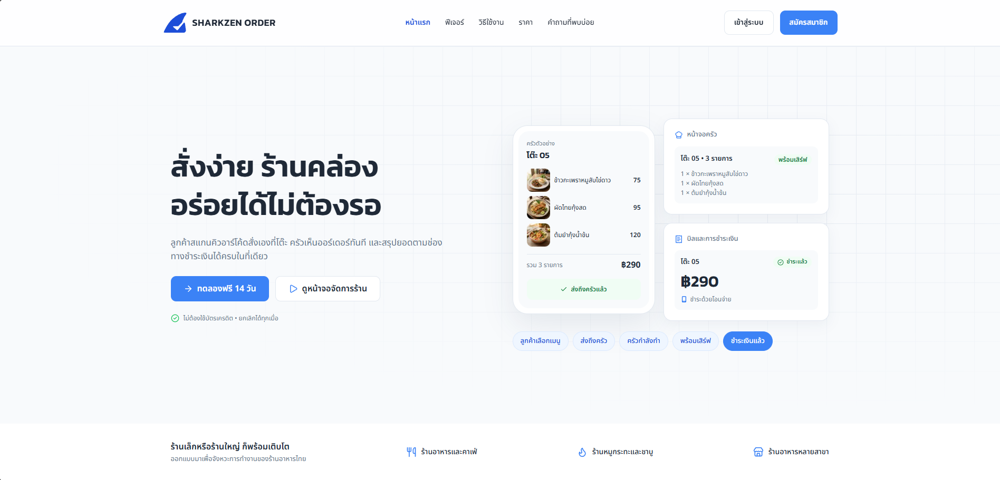
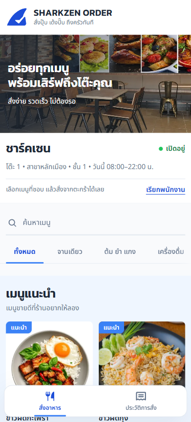
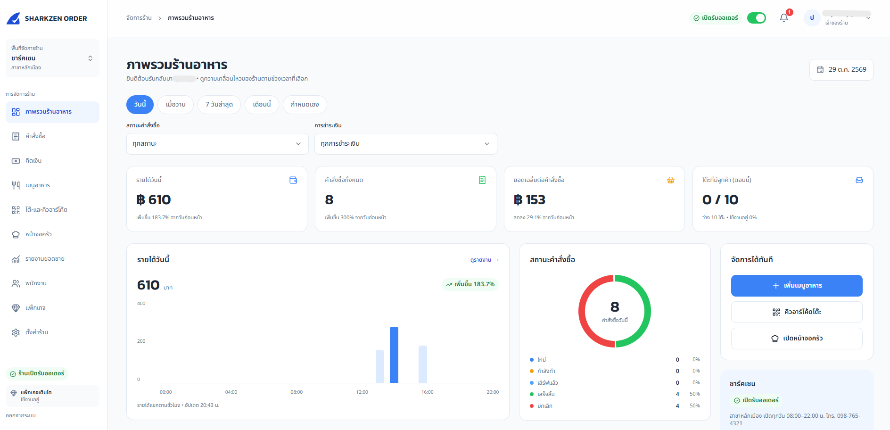
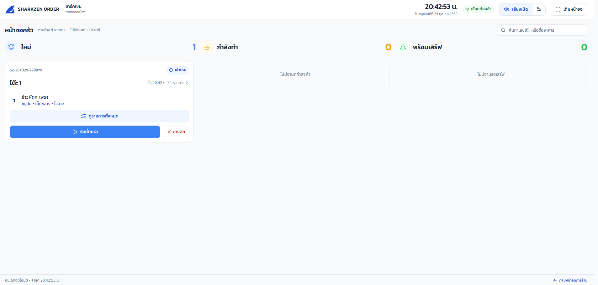
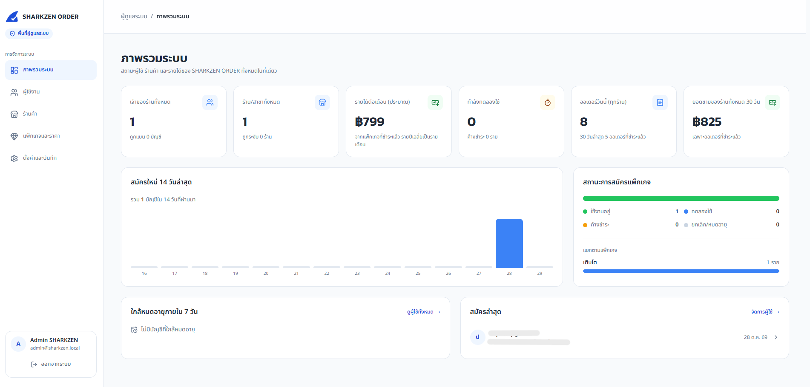
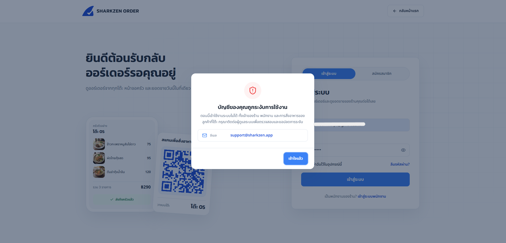

# SHARKZEN ORDER

[English](README.md) | **ภาษาไทย**



SHARKZEN ORDER คือระบบสั่งอาหารผ่านคิวอาร์โค้ดสำหรับร้านอาหาร ลูกค้าสแกนคิวอาร์ที่โต๊ะ เลือกอาหารจากมือถือตัวเอง แล้วส่งเข้าครัวได้เลย ไม่ต้องโหลดแอป ไม่ต้องรอพนักงานมารับออเดอร์

นอกจากฝั่งลูกค้า ก็มีหลังร้านครบ ทั้งออเดอร์ หน้าจอครัว คิดเงิน เมนู โต๊ะ พนักงาน และรายงานยอดขาย และเพราะทำเป็นแบบ SaaS ก็เลยมีฝั่งแอดมินระบบไว้ให้ผมจัดการร้านทั้งหมด ตั้งแพ็กเกจ ราคา และแบนบัญชีได้

## ทำไมถึงทำ

ร้านเล็กๆ ส่วนใหญ่จะจบที่ใบสั่งกระดาษ ตะโกนบอกครัว และสมุดจดยอดขายตอนท้ายวัน ส่วนระบบ POS ของใหญ่ๆ ก็แพงและหนักเกินไปสำหรับร้านสิบโต๊ะ ผมเลยอยากได้อะไรที่อยู่ตรงกลาง คือตั้งค่าเสร็จได้ในบ่ายเดียว ราคาร้านเล็กจ่ายไหว แต่ครอบคลุมตั้งแต่ลูกค้านั่งลงจนถึงเงินเข้าลิ้นชัก

## ทำอะไรได้บ้าง

### ฝั่งลูกค้า (ไม่ต้องล็อกอิน)

สแกนคิวอาร์ที่โต๊ะ เมนูจะเปิดในเบราว์เซอร์เลย

- ดูเมนูตามหมวด เห็นเมนูแนะนำ เลือกตัวเลือกเพิ่ม (ระดับความเผ็ด ของเพิ่ม โน้ตของแต่ละจาน)
- ส่งออเดอร์เข้าครัว แล้วดูสถานะแบบสดๆ
- สั่งเพิ่มทีหลังได้ ทุกอย่างรวมอยู่ในบิลโต๊ะเดียวกัน
- กดเรียกพนักงานได้ในปุ่มเดียว



### ฝั่งร้าน

| หน้า | ใช้ทำอะไร |
| --- | --- |
| ภาพรวมร้านอาหาร | ยอดขายวันนี้ ออเดอร์ เมนูขายดี ดูทีเดียวจบ |
| คำสั่งซื้อ | ดูทุกออเดอร์ เปลี่ยนสถานะ ยกเลิกพร้อมเหตุผล |
| หน้าจอครัว | จอใหญ่สำหรับพ่อครัว ออเดอร์ใหม่เข้ามาพร้อมเสียงแจ้งเตือน |
| คิดเงิน | จ่ายทั้งโต๊ะทีเดียว เงินสด/โอน/จ่ายที่เคาน์เตอร์ ส่วนลด เงินทอน ใบเสร็จ |
| เมนูอาหาร | หมวดหมู่ เมนู รูป ตัวเลือก ลากจัดลำดับ ปิดเมนูที่ของหมด |
| โต๊ะและคิวอาร์ | สร้างโต๊ะ เปิด/ปิดโต๊ะ พิมพ์คิวอาร์ |
| รายงานยอดขาย | ยอดขายตามช่วงเวลาและช่องทางชำระเงิน |
| พนักงาน | สร้างบัญชี กำหนดบทบาทและสิทธิ์รายหน้า |
| แพ็กเกจ | การสมัครใช้งาน การใช้งานเทียบกับเพดาน ใบแจ้งหนี้ |
| ตั้งค่าร้าน | เวลาเปิด-ปิด ค่าบริการ พร้อมเพย์ เสียงแจ้งเตือน |

ทุกอย่างอัปเดตสดผ่าน WebSocket ออเดอร์ใหม่จึงเด้งเข้าหน้าจอครัวและหน้าคำสั่งซื้อโดยไม่ต้องรีเฟรช




### พนักงาน

เจ้าของร้านตั้งชื่อผู้ใช้และรหัสผ่านให้พนักงานแล้วแจ้งพนักงานเอง พนักงานเข้าสู่ระบบที่ `/staff-login` ด้วย **รหัสร้าน** (ดูได้ที่หน้าพนักงาน) ชื่อผู้ใช้ และรหัสผ่าน

แต่ละบทบาทมีสิทธิ์ของตัวเอง เช่น แคชเชียร์เห็นหน้าคิดเงินแต่ไม่เห็นรายงาน พ่อครัวเห็นแค่หน้าครัว และสิทธิ์พวกนี้ตรวจที่ฝั่งเซิร์ฟเวอร์ทุกคำขอ ไม่ได้แค่ซ่อนเมนูไว้เฉยๆ

### แพ็กเกจและการชำระเงิน

ทุกร้านเริ่มด้วยช่วงทดลองใช้ฟรี หลังจากนั้นจ่ายรายเดือนหรือรายปี ด้วยบัตร (ตัดอัตโนมัติ) หรือพร้อมเพย์ (จ่ายเป็นรอบ) ผ่าน Stripe แพ็กเกจกำหนดว่าร้านมีได้กี่สาขา กี่โต๊ะ กี่บัญชีพนักงาน

### แอดมินระบบ (ของผมเอง)

พื้นที่แยกต่างหากที่ `/admin`

- **ภาพรวม:** ผู้ใช้ ร้านค้า รายได้ต่อเดือนโดยประมาณ คนสมัครใหม่ ใครใกล้หมดอายุ
- **ผู้ใช้งาน:** ค้นหา แบน/ปลดแบน เปลี่ยนแพ็กเกจ เพิ่มหรือลดวันใช้งาน
- **ร้านค้า:** ระงับเฉพาะสาขาได้ โดยไม่กระทบสาขาอื่นของเจ้าของคนเดียวกัน
- **แพ็กเกจและราคา:** สร้าง แก้ไข ซ่อน หรือลบแพ็กเกจ ราคา เพดาน จุดเด่น และจำนวนวันทดลอง เก็บในฐานข้อมูลทั้งหมด ไม่มีค่าตายตัวในโค้ด หน้าแรกกับหน้าสมัครดึงจาก API
- **ตั้งค่าและบันทึก:** วันทดลอง ช่องทางติดต่อ และบันทึกทุกอย่างที่แอดมินทำ

เมื่อบัญชีถูกแบน เจ้าของ พนักงาน และลูกค้าของร้านนั้นใช้อะไรไม่ได้เลย ใครที่ล็อกอินค้างอยู่จะเจอหน้าต่างให้ติดต่อผู้ดูแลระบบ ปลดแบนแล้วทุกอย่างกลับมา ข้อมูลไม่หาย

บัญชีแอดมินเท่านั้นที่มี 2FA (แอป Authenticator) และบน production บังคับใช้ นอกจากนี้ยังจำกัดให้เข้า `/admin` ได้เฉพาะบาง IP ได้ด้วย




## เทคโนโลยีที่ใช้

- **Frontend:** Next.js 16, React 19, Tailwind CSS 4, Framer Motion
- **Backend:** Fastify 5, TypeScript, Prisma 6, Zod
- **ฐานข้อมูล:** PostgreSQL 16
- **เรียลไทม์:** Socket.IO
- **ชำระเงิน:** Stripe (บัตรและพร้อมเพย์)
- **รูปภาพ:** Cloudflare R2 (แปลงเป็น WebP ก่อนอัปโหลด)
- **อีเมล:** SMTP (ตอนพัฒนาใช้ Mailpit)
- **Deploy:** Docker Compose + Caddy (HTTPS อัตโนมัติ)

```
sharkzen-order/
├── backend/     API, สกีมาฐานข้อมูล, เทสต์
├── frontend/    แอป Next.js (ลูกค้า, ร้าน, แอดมิน)
├── ops/         Caddyfile, สคริปต์สำรองและกู้ข้อมูล
├── docs/        คู่มือ deploy, ภาพหน้าจอ
└── docker-compose.yml        ตอนพัฒนา: Postgres + Mailpit
    docker-compose.prod.yml   ชุดสำหรับ production
```

## รันในเครื่อง

ต้องมี Node.js 24+ และ Docker

```bash
# 1. ฐานข้อมูล + เซิร์ฟเวอร์อีเมลปลอม
docker compose up -d

# 2. backend
cd backend
cp .env.example .env        # อย่างน้อยต้องใส่ JWT_SECRET และ STRIPE_SECRET_KEY
npm install
npx prisma migrate deploy
npm run prisma:seed         # แพ็กเกจ ค่าตั้งระบบ แอดมิน เมนูตัวอย่าง
npm run dev                 # http://localhost:3001

# 3. frontend (เปิดเทอร์มินัลใหม่)
cd frontend
cp .env.example .env        # ชี้ไป backend พอร์ต 3001 ให้แล้ว
npm install
npm run dev                 # http://localhost:3000
```

อีเมล (OTP, รีเซ็ตรหัสผ่าน) จะไปอยู่ที่ Mailpit ดูได้ที่ http://localhost:8025

seed จะสร้างแอดมินสำหรับตอนพัฒนาเท่านั้น

```
admin@sharkzen.local
Aa123456
```

อย่าเอารหัสนี้ไปใช้กับของจริง

### ลองใช้งาน

1. เข้า `/register` สมัครเป็นเจ้าของร้าน ยืนยัน OTP จาก Mailpit แล้วเลือกแพ็กเกจ
2. เพิ่มโต๊ะกับเมนู แล้วพิมพ์คิวอาร์ของโต๊ะ
3. เปิดโต๊ะ แล้วสแกน (หรือเปิดลิงก์) บนมือถือเพื่อลองสั่งอาหาร
4. ดูออเดอร์เด้งที่หน้าครัว แล้วไปคิดเงินที่หน้าคิดเงิน
5. ล็อกอินด้วยแอดมินที่ `/login` แล้วเดินดูที่ `/admin`

### เทสต์

```bash
cd backend
npm test
```

เทสต์รันบนสกีมาชั่วคราวใน Postgres จึงไม่แตะข้อมูลที่ใช้พัฒนาอยู่

## Deploy

บน VPS เมื่อกรอก `.env` เรียบร้อยแล้ว

```bash
git pull && docker compose up -d --build
```

คำสั่งนี้รัน migration และ seed ครั้งแรกให้เอง และรันซ้ำก็ไม่ทับข้อมูลที่แก้ไปแล้ว ส่วนการสำรองข้อมูล กู้คืน monitoring และเช็กลิสต์อยู่ใน [docs/DEPLOY.md](docs/DEPLOY.md)

## ที่ควรรู้

- ตอนนี้ให้รัน backend เครื่องเดียว ส่วนเรียลไทม์ยังไม่มี Redis adapter
- ยังไม่มีระบบแจ้ง error อัตโนมัติ (เช่น Sentry) และยังไม่ได้ตั้ง CI
- ยังไม่มีฟีเจอร์ลบบัญชี / ส่งออกข้อมูลของผู้ใช้
